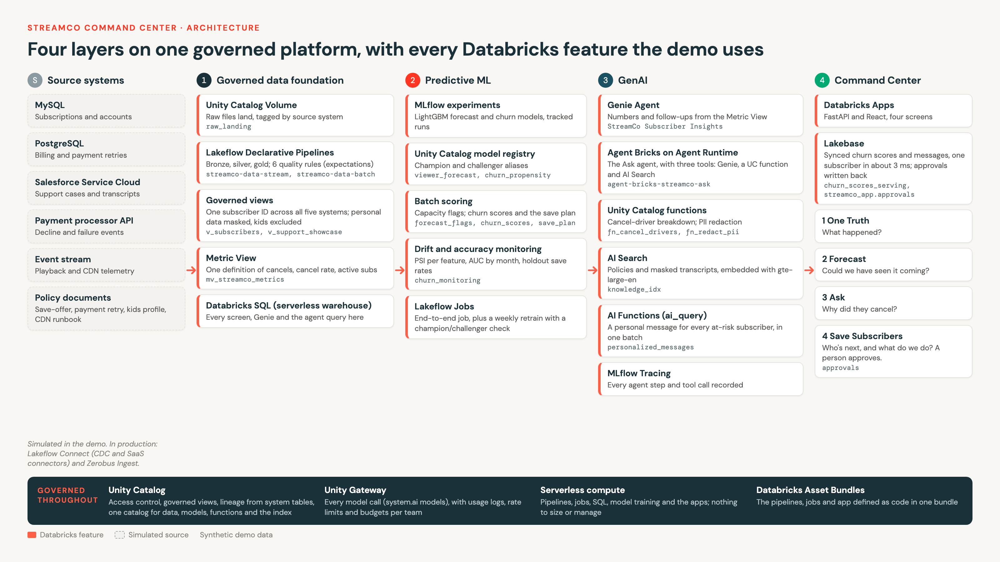

# StreamCo Command Center

**Industry:** Media and entertainment, subscription streaming. **Problem:** after the biggest live event of the
year, a streaming company can't agree on how many subscribers cancelled, can't see capacity hot spots before they
happen, and reaches every at-risk subscriber with the same generic offer, if at all.

**Outcome on one event (synthetic data):** one governed cancel number instead of three team counts, the one
overloaded delivery cell (Dallas, 97% of capacity) flagged before kickoff, about 30,000 subscribers at risk found
before they cancel, and a save plan that keeps about 2,100 of them: **$302k revenue protected for $42k, about 7 to 1**.
Every at-risk subscriber gets a personal message that follows the save-offer policy, and a person approves the plan
before anything is sent.

All data is synthetic: a fictional company, people and accounts, generated by the notebooks in `data/`.



## The data journey

| Stage | Built with | Where |
|---|---|---|
| **Ingest** (Lakeflow) | Synthetic source files for five systems (MySQL subscriptions, Postgres billing, Salesforce support, a payment processor API, playback telemetry) land in a Unity Catalog Volume; two **Lakeflow Declarative Pipelines** build bronze, silver and gold with 6 quality rules | `data/notebooks/`, `data/pipelines/`, `resources/pipelines.yml` |
| **Govern** (Unity Catalog) | One subscriber ID across all five systems; governed views mask personal data and exclude kids-only accounts; a **Metric View** defines the governed cancel count, reconciled to the billing ledger; lineage from system tables; models, functions and the search index all in Unity Catalog | `notebooks/01_setup.py`, `sql/` |
| **Serve** (Lakebase) | Churn scores and personalized messages synced from Unity Catalog into **Lakebase** for one-subscriber reads in about 3 ms; the app writes plan approvals to its own Lakebase schema | `notebooks/09_lakebase.py`, `app/backend/lakebase.py` |
| **Make it intelligent** (ML and GenAI) | A LightGBM viewership forecast and churn model (MLflow, Unity Catalog registry, champion/challenger), drift and accuracy monitoring, and a weekly retrain job (schedule paused); an **AI Search** index over policies and masked support transcripts; an **Agent Bricks** agent that explains the cancellations with three tools; one personalized message per at-risk subscriber with `ai_query`; every model call through Unity Gateway | `notebooks/02`, `03`, `05`, `06`, `07`, `08`, `agent/`, `prompts/` |
| **Ask in natural language** (Genie Agent) | Genie Agent "StreamCo Subscriber Insights" over the Metric View and governed tables; it declines when two sources disagree | `notebooks/04_genie.py` |
| **Surface it** (Databricks App) | The Command Center app (FastAPI and React): One Truth, Forecast, Ask, Save Subscribers, deployed with its SQL warehouse and Lakebase resources | `app/`, `resources/app.yml` |

**Execution evidence:** [`evidence/`](evidence/README.md) has the text output of every stage: notebook outputs
cell by cell for each job run, pipeline quality results, query results, model metrics, live Genie and agent
answers, MLflow traces, Lakebase checks and the deployed app's status. `scripts/collect_evidence.py` regenerates it.

## Repo layout

```
data/          synthetic data generation and the two Lakeflow pipelines
notebooks/     01 setup (governed views, metric view) · 02 forecast · 03 churn · 04 Genie Agent ·
               05 personalized messages · 06 Ask agent run · 07 AI Search index · 08 monitoring · 09 Lakebase
sql/           views and the metric view, run by 01_setup
agent/         the Ask agent (Agent Bricks CLI, Agent Runtime)
app/           the Databricks App: backend/ (FastAPI), frontend/ (React), fixture.json (screen data)
resources/     bundle resources: pipelines, jobs, the app
scripts/       export_fixture.py (screen data from the tables), collect_evidence.py, log_ask_traces.py
deck/          the presentation deck and the architecture diagram
docs/          demo script, grants
evidence/      execution evidence
```

## Run it

Set your Databricks CLI profile (`my-workspace` below), a SQL warehouse ID for the `warehouse_id` variable in
`databricks.yml`, and a catalog you can write to (`catalog`, default `cindy_wu_catalog`); everything lands in
schema `streamco` on serverless.

```bash
databricks bundle deploy                          # pipelines, the end-to-end job, the weekly retrain job, the app
databricks bundle run streamco_pipeline           # generation -> pipelines -> notebooks 01-09, in order
cd agent && uv sync && uv run agentbricks -p my-workspace deploy   # the Ask agent
cd app/frontend && npm install && npm run build   # then redeploy the bundle and run streamco_command_center
```

While building, each stage ran as its own serverless run (listed in [`evidence/runs/`](evidence/runs/README.md));
the job chains the same notebooks. Grants the deployed app and agent need are listed in `docs/grants-pending.md`.

### Run the app locally

```bash
cd app
uv venv .venv && uv pip install -p .venv/bin/python -r requirements.txt
cd frontend && npm install && npm run build && cd ..
FORCE_FIXTURE=1 .venv/bin/uvicorn backend.main:app --port 8010        # recorded screen data only
DATABRICKS_WAREHOUSE_ID=<warehouse-id> GENIE_AGENT_ID=01f1dbf923701cb3b3ec3d2fcbee9e87 \
  .venv/bin/uvicorn backend.main:app --port 8010                       # with the live parts
```

**Screens** come from `app/fixture.json`, exported from the real tables by `scripts/export_fixture.py`, so the
numbers can't change mid-presentation. **Live parts** fall back to it per request: Ask (the deployed agent, or the
same tools in process), Genie follow-ups, Regenerate (one model call with the batch prompt and its rules), the
Lakebase lookup on each sample subscriber, and Approve (a row in Lakebase). Keys: `1`-`4` screens, `G` governance
drawer, `H` how it works, `R` reset, `F` recorded only.

## Presenting

The deck is `deck/index.html` (open in Chrome; print to PDF with background graphics). The talk track, persona
lines and pushback answers are in `docs/demo-script.md`.
